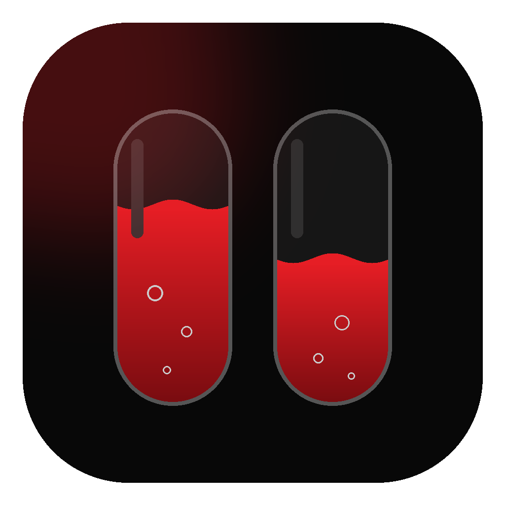

<p align="center">
  
</p>

<h1 align="center">Nothing X — unofficial desktop app</h1>

<p align="center">
  A community-made Windows app for Nothing and CMF earbuds.<br>
  <b>Not made by, affiliated with or endorsed by Nothing Technology.</b>
</p>

---

## Features

- **Fizzy battery** — live earbud battery shown as liquid, with four styles (Soda, Sparkling, Bubble Pop, Classic); fizzes faster while charging
- **Quick tiles** — switch noise control, EQ and game mode straight from the dashboard
- **Noise control** — noise cancellation (high / mid / low / adaptive), transparency, off
- **Equalizer** — presets plus an advanced mode
- **Bass enhance**, **low latency mode**, **in-ear detection**
- **Gestures** — set what each pinch does, per earbud
- **Themes** — seven accent colours
- **Live status** — shows when the earbuds disconnect, tap to reconnect
- **Preview mode** — try the app without earbuds

## Install (Windows)

1. Download `Nothing-X-Setup-x.y.z.exe` from the [Releases](../../releases) page.
2. Run it. Windows may show *"Windows protected your PC"* because the app isn't code-signed — click **More info → Run anyway**.
3. Pair your earbuds in Windows Bluetooth settings, open **Nothing X** and click **Initialize Link**.

Running a newer installer updates the app in place and keeps your settings.

## Compatibility

Tested with the **Nothing Ear / Ear (a)**. Other Nothing and CMF models that the original
[ear (web)](https://github.com/radiance-project/ear-web) project supports may work, but some
model-specific features might not yet.

## Build from source

Needs [Node.js](https://nodejs.org/) 20 or newer.

```bash
npm install          # Electron + build tools (a few hundred MB)
npm start            # build the interface and open the app
npm run dist:win     # build the Windows installer into release/
```

To work on just the interface in a browser: run `start_app.bat` (or `npm --prefix web run dev`)
and open `http://localhost:5173` in Chrome or Edge. Add `?demo` to the address to preview without earbuds.

| Folder | What's in it |
| --- | --- |
| `web/` | The interface (Vite + plain JavaScript): `src/main.js`, `src/style.css`, `src/connection.js` (earbud protocol), `src/fizz.js` (battery animation) |
| `main.js`, `electron/` | The desktop wrapper (Electron) and the earbud picker window |
| `resources/` | App icon |

## Credits

Built on **[ear (web)](https://github.com/radiance-project/ear-web)** by **RapidZapper** (idea and backend work)
and **[Bendix](https://www.mrbrickstar.de/)** (frontend work), whose reverse-engineered protocol makes this possible.

Desktop app, redesign and new features by **[Coffee2028](https://github.com/Coffee2028)**.

Fonts: Italiana, Manrope, Space Mono and Doto, all under the SIL Open Font License (see `web/public/fonts/`).

## Legal

This application and code is published under the **GNU General Public License v3.0** — see [LICENSE](LICENSE).

Nothing Technology Limited or any of its affiliates, subsidiaries, or related entities (collectively, “Nothing Technology”) is a valid licensee and can use this app for any purpose, including commercial purposes, without compensation to the developers of this app. Nothing Technology is not required to comply with the terms of the GNU General Public License v3.0.

This app is not affiliated with, sponsored by, or endorsed by Nothing Technology. The developers of this app take no responsibility for the accuracy or completeness of the content and materials provided in this app. "Nothing" and related names and marks are the property of Nothing Technology Limited, 80 Cheapside, London EC2V 6EE, and are protected by copyright, trademark, and other intellectual property laws. Nothing Technology reserves all rights.
